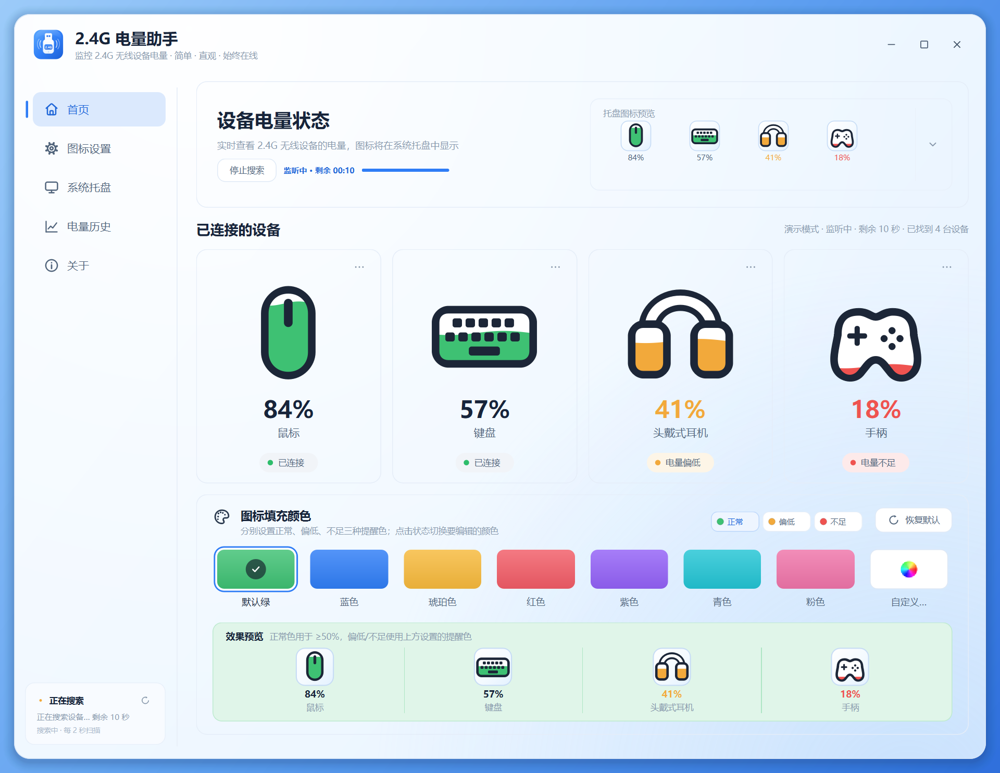
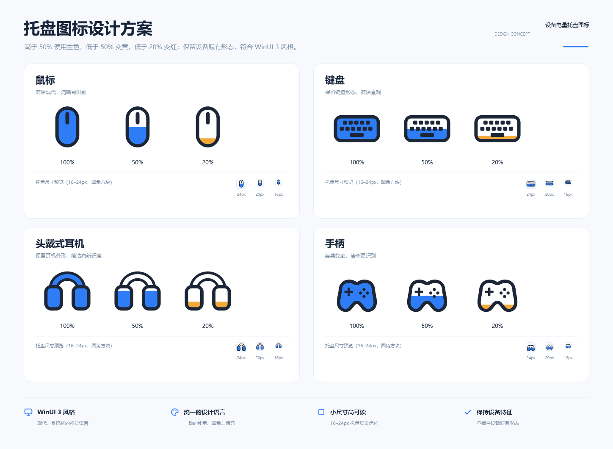
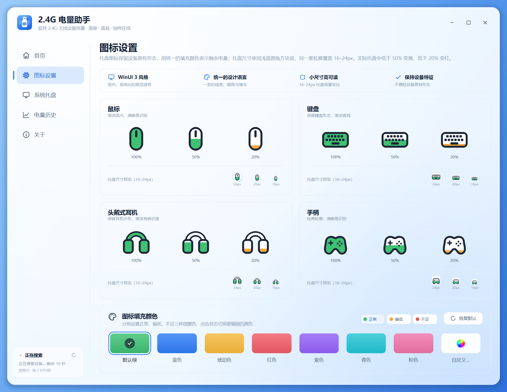
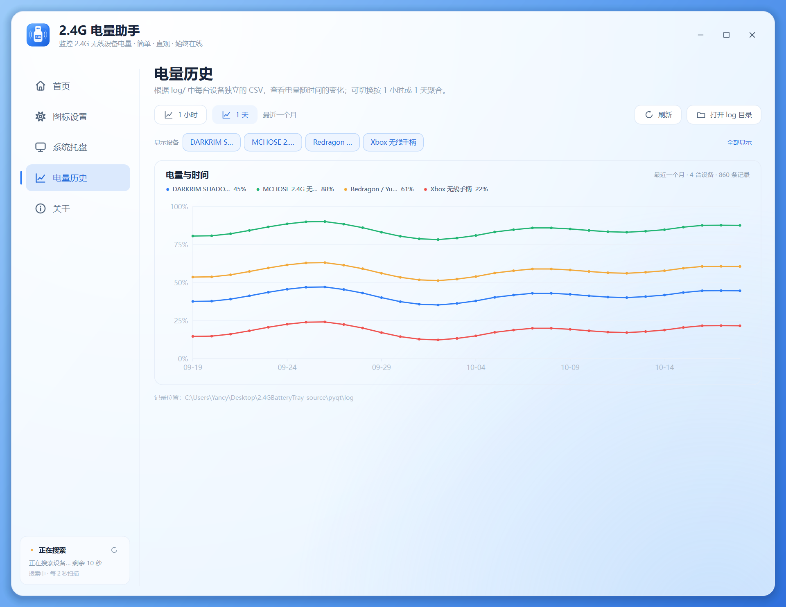

# 2.4G 电量助手 · PyQt6 重写版

Windows 上的 2.4G 无线键盘 / 鼠标 / 耳机 / 手柄电量托盘工具。  
主界面参考图 1，托盘图标参考图 2 的「设备轮廓 + 电量填充」设计：保留设备原有形态，
用填充颜色表示剩余电量，并在外面加浅蓝圆角方块底；正常 / 偏低 / 不足三种提醒色
可以分别设置。应用图标是一枚蓝白 USB 2.4G 适配器，使用 SVG 绘制。





## 特性

- **现代无边框窗口**：浅蓝玻璃质感、圆角卡片、自绘标题栏，支持拖动、最大化、边缘缩放
- **首页总览**：托盘图标预览、已连接设备卡片、三档提醒色与效果预览
- **图标设置页**：鼠标 / 键盘 / 头戴式耳机 / 手柄四套图标，100% / 50% / 20% 与
  24 / 20 / 16px 托盘尺寸预览
- **参考图 2 的托盘图标**：设备轮廓不变，电量以彩色填充表示；每个托盘图标带
  浅蓝圆角方块底。正常 / 偏低（<50%）/ 不足（<20%）三种提醒色可分别设置
- **耳机图标**：头梁改成镂空圆环，填充线按整个耳机的高度计算；电量低时
  头梁保持白色，足够高时才会填到连接部分
- **单次扫描 10–60 秒可调**：自动扫描间隔可选 3 分钟 / 10 分钟 / 30 分钟 /
  1 小时 / 3 小时；扫描期间每 2 秒读取一次，首页、设备标题和侧栏显示倒计时
- **电量历史**：每次成功监听按设备追加到同一个 CSV（`log\<类型>-<VID>-<PID>.csv`）；
  侧栏“电量历史”按 1 小时（最近 24h）或 1 天（最近一个月）聚合显示曲线，
  可逐台勾选要显示的设备
- **蓝白应用图标**：USB 2.4G 适配器造型，SVG 绘制并导出多尺寸 `app.ico` / `app.png`
- **托盘显示开关**：未读取到电量的设备默认不显示托盘图标；已连接设备可在主界面
  设备卡片的 `···` 菜单中逐台“在托盘显示 / 从托盘隐藏”，状态会保存
- **每台设备一个托盘图标**：tooltip 显示设备类型、精确电量和设备名
- **托盘菜单**：打开主界面、立即刷新、开机自启、图标设置、退出
- **自动扫描间隔** 3 分钟 / 10 分钟 / 30 分钟 / 1 小时 / 3 小时；
  单次扫描 10–60 秒可调
- **关闭到托盘、开机自启（HKCU Run）、单实例运行**
- **后台线程读取 HID**，界面不卡顿；托盘不可用时自动保持窗口显示
- **`--demo` 预览模式**：不连接硬件也能查看完整界面（截图中使用）
- **便携数据**：设置、日志保存在 exe 同目录；目录不可写时自动回退到 `%APPDATA%`

## 界面

| 页面 | 内容 |
|---|---|
| 首页 | 设备电量状态、托盘图标预览、设备卡片、三档提醒色与效果预览；卡片 `···` 控制托盘显示 |
| 图标设置 | 四类设备图标在 100/50/20% 下的形态，以及 16–24px 圆角方块托盘尺寸对比 |
| 系统托盘 | 自动扫描间隔、单次扫描时长、关闭到托盘、开机自启、托盘图标列表（含隐藏状态）、数据目录 |
| 电量历史 | 每台设备的电量-时间曲线，支持 1 小时 / 1 天聚合与逐台显示筛选 |
| 关于 | 版本信息、功能、使用提示、已验证协议、参考链接 |





## 运行

要求 Windows 10/11 + Python 3.10+。项目自带 `.venv`（Python 3.11 + PyQt6 6.4.2，
并装有 Pillow / PyInstaller），可以直接运行：

```powershell
cd pyqt
.\.venv\Scripts\Activate.ps1
python src\main.py
```

如果需要重建虚拟环境（需要能访问 PyPI）：

```powershell
cd pyqt
py -3.12 -m venv .venv
.\.venv\Scripts\python.exe -m pip install -r requirements-dev.txt
```

用示例设备预览界面（不读取 HID）：

```powershell
python src\main.py --demo
```

其他参数：

| 参数 | 说明 |
|---|---|
| `--minimized` | 启动后直接隐藏到托盘（开机自启使用） |
| `--demo` | 使用 4 台示例设备展示界面 |
| `--no-tray` | 禁用托盘图标，用于诊断 |
| `--tray-selftest` | 创建演示托盘图标 2.5 秒，用于排查托盘环境 |

## 从源码构建

`build.ps1` 默认使用项目自带的 `.venv\Scripts\python.exe`。如果只想复制一段命令快速构建，
见 [pyinstaller-build.txt](pyinstaller-build.txt)：

```powershell
cd pyqt
powershell -ExecutionPolicy Bypass -File .\build.ps1
# 如果 Python 不在默认位置：
powershell -ExecutionPolicy Bypass -File .\build.ps1 -Python "C:\path\python.exe"
```

构建使用 PyInstaller 的 `--onedir --windowed`，输出：

```text
pyqt\release\2.4GBatteryTray\2.4GBatteryTray.exe
pyqt\release\2.4GBatteryTray-win64.zip
```

便携版不需要安装 Python，保持 exe 与 `_internal` 文件夹在一起即可。

## 源码结构

```text
pyqt/
├── src/
│   ├── main.py            # 入口：DPI、单实例、托盘自检
│   ├── app_window.py      # 无边框主窗口、标题栏、导航、窗口状态
│   ├── page_home.py       # 首页：hero、托盘预览、设备卡片、颜色卡
│   ├── page_icons.py      # 图标设置页（参考图 2 的图标矩阵）
│   ├── page_tray.py       # 系统托盘页：刷新间隔、行为、设备列表
│   ├── page_history.py    # 电量历史页：自绘电量-时间曲线
│   ├── page_about.py      # 关于页
│   ├── color_card.py      # 共享的颜色设置卡与效果预览
│   ├── widgets.py         # 按钮、开关、色板、状态胶囊等自绘控件
│   ├── icons.py           # QPainter 设备图标 + 托盘方块底 / 应用图标渲染
│   ├── app_icon_svg.py    # 蓝白 USB 2.4G 适配器应用图标（SVG 源）
│   ├── ui_icons.py        # 24x24 线性 UI 图标
│   ├── theme.py           # 颜色、字体、QSS、窗口渐变背景
│   ├── model.py           # DeviceView、设备类型识别、演示数据
│   ├── history.py         # 按设备写 CSV、读取并聚合历史数据
│   ├── poller.py          # 后台 HID 轮询（daemon 线程，退出不阻塞）
│   ├── tray.py            # QSystemTrayIcon 多图标 + 菜单
│   ├── tray_probe.py      # Shell_NotifyIcon 可用性探测
│   ├── single_instance.py # 命名互斥量 + 文件激活信号
│   ├── settings.py        # 设置持久化、开机自启
│   ├── log.py             # 日志
│   ├── battery.py         # 2.4G HID 电量协议（复用原项目）
│   └── hid_win.py         # Windows HID ctypes 访问层（复用原项目）
├── assets/
│   ├── app.ico / app.png
│   ├── app-icon.svg
│   ├── screenshot.png
│   ├── icon-settings.png
│   ├── history.png
│   └── tray-preview.png
├── tools/
│   ├── capture.py         # 生成 README 截图
│   └── make_assets.py     # 生成 app.ico 与托盘图标设计图
├── build.ps1
├── pyinstaller-build.txt    # 复制即用的 PyInstaller 快速命令
├── requirements.txt
├── requirements-dev.txt
└── README.md
```

## 与 tkinter 版本的关系

- 原 `src/`（tkinter）**保持原样**，可以继续运行和对照。
- `hid_win.py`、`battery.py` 原样复用：已验证的厂商协议、标准 HID 电量、
  Logitech HID++ 兜底都保持不变。
- 界面从 tkinter 改为 PyQt6 自绘：圆角、渐变、动效、悬停反馈、
  响应式设备卡片网格。
- 托盘从 ctypes `Shell_NotifyIcon` 改为 `QSystemTrayIcon`，图标由 QPainter
  直接生成多尺寸 `QIcon`（16–64px），不再写临时 `.ico` 文件。
- 新增图标设置页、电量历史页、三档颜色自定义、60 秒搜索、窗口位置记忆、
  单实例激活、`--demo` 预览。

## 已验证设备

| 设备 | VID:PID | 读取方式 |
|---|---|---|
| Redragon / Yunzii 2.4G 键盘接收器（Compx） | `3554:FA09` | `0x13` 命令 `0x05` → `0x0A` 事件，电量在 byte 6 |
| MCHOSE 2.4G 无线鼠标接收器 | `258A:0136 / 0138` | Feature Report `0x09` 发送 `0x13 44 01`，再 GET 完成事务；`0x0A` 事件 byte 3 为电量 |
| Scyrox / VXE / VGN | `3554:F5F7` 等 | 17 字节 `0x08` 协议兜底 |
| ATK / VXE 鼠标 | `373B:1216` | 64 字节 `0x7D 72 ...` 协议兜底 |
| DARKRIM SHADOW | `3654:6901` | TLV + CRC16 兜底 |
| 罗技 HID++ / 标准 HID 电量 | 任意 | Feature 字段兜底 |

实际测试中鼠标读数为 25–30%，与厂商驱动显示接近；设备休眠或厂商软件独占 HID 时
可能读不到。

## 便携数据

设置、日志和单实例激活标记都写在**程序所在目录**：

| 文件 | 内容 |
|---|---|
| `settings.json` | 自动扫描间隔、单次扫描时长、关闭到托盘、三档颜色、每台设备的托盘显示开关、窗口位置 |
| `app.log` | 启动、托盘与 HID 读取日志 |
| `show.request` | 重复启动时用于唤起已有窗口的临时标记 |
| `log\<类型>-<VID>-<PID>.csv` | 每台设备唯一的电量历史，同一设备始终追加到同一个文件 |

源码运行时是 `pyqt/` 目录；打包后是 exe 同目录（例如 `release\2.4GBatteryTray\`）。
如果该目录不可写（例如放在 Program Files），会自动回退到
`%APPDATA%\2.4GBatteryTray\`。

## 注意

- 设备休眠时接收器可能不回复：**按一下键盘、移动一下鼠标**，再点“搜索设备”。
- 启动后会自动扫描；单次扫描时长可在 10–60 秒内设置，自动扫描间隔为
  3 分钟 / 10 分钟 / 30 分钟 / 1 小时 / 3 小时。扫描时顶部和侧栏显示倒计时，
  点“停止搜索”可提前结束。
- 每次成功读取都会写入该设备唯一的 `log\<类型>-<VID>-<PID>.csv`；同一设备
  不会因为一次检测或序列号变化而新建文件。电量历史页默认按 1 小时聚合最近
  24 小时，点“1 天”聚合最近一个月。
- 电量历史页可逐台勾选设备；在首页设备卡片的 `···` 菜单点“查看电量记录”会
  跳转到只显示该设备的曲线，正常点击侧栏“电量历史”则全部显示。
- 未读取到电量的设备默认不生成托盘图标；可在主界面设备卡片的 `···` 菜单中
  逐台“在托盘显示 / 从托盘隐藏”，选择会保存。
- 托盘图标颜色分三档：正常（≥50%）、偏低（<50%）、不足（<20%），在颜色卡里点
  上方状态切换，再用色板或“自定义…”分别设置。
- 耳机头梁的填充按整个耳机高度计算；低电量时头梁保持白色镂空，电量足够高时
  才会填充到连接部分。
- 不需要让厂商驱动常驻；如果它独占了 HID，关闭后重试。
- Windows 会把新托盘图标收进溢出区（`^`），可在任务栏设置中固定显示。程序在检测到
  图标不可见时会给出一次提示，托盘页也提供“打开任务栏设置”按钮。
- 受限终端 / 沙箱 / 远程桌面可能直接拒绝 `Shell_NotifyIcon`（Win32 5）：程序会显示
  “托盘不可用”并保持窗口显示，关闭窗口会直接退出，不会隐藏到找不到的地方。
  请从资源管理器直接运行 exe 或快捷方式。
- 单实例采用命名互斥量；重复启动会通过数据目录中的激活信号唤起已有窗口。
- 低完整性 / 远程桌面环境可能无法创建托盘图标，此时程序会保持窗口显示。

## 参考

- [原 CLI 项目 / 协议来源](https://github.com/yszyszysz233/2.4G-battery-viewer)
- [MCHOSE G98 V2 的 Feature Report 0x09 实现](https://github.com/DX-Cloud/MchoseG98V2AutoLight)
- [MCHOSE K7 Ultra 公开协议整理](https://gitlab.com/unk9201422/Mchose/-/wikis/Protocol-Specification)

## License

MIT
